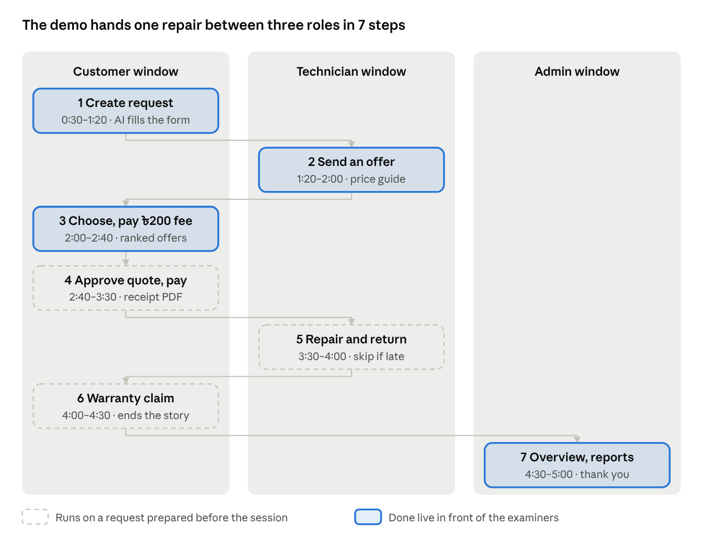

# Sarabo — 5-Minute Live Demo Plan

The live demo that follows the slides. It continues the same Rahim story as the [slide scripts](script-5min.md).
The click-by-click button reference is in [demo-script.md](demo-script.md); the long demo is in [demo-script-detailed.md](demo-script-detailed.md).

## Goal: one repair, three roles, one story

In 5 minutes, show a single phone repair moving from request to payout, switching between the Customer, Technician and Admin windows. Tell it as one real-life story so the examiners follow a person, not a list of features.

**The one-line story:** Rahim's cracked phone gets a fair written price, live tracking and a warranty, and the technician Karim gets steady work and guaranteed payment.

**Open with this (30 seconds, say it, don't read it):**

> "This is a typical situation, not a real customer. Rahim in Ambarkhana, Sylhet, cracks his Samsung Galaxy A54. A shop says 2,500 taka, keeps the phone a week, then asks 4,500. No written quote, no receipt. Ten days later the touch fails again and the shop blames him. Let me show you the same repair on Sarabo, live."

Three rules keep it inside 5 minutes:

1. **Do the slow steps before the session.** One request is already at *Quote ready*, and the finished Galaxy A54 with its warranty claim is open in a tab.
2. **Never type passwords live.** All three accounts are signed in beforehand, one per window.
3. **Talk while you click.** Every click has one sentence attached (see "What to say at each step"); never wait silently for a page.

## Before you start: 15-minute setup

Do all of this before the examiners sit down; a live demo fails on setup, not on code.

**App and network**

- [ ] Run the **local** app: `npm run dev` in `sarabo-server` (port 3000) and `sarabo-client` (`http://localhost:5173`). It has the prepared data.
- [ ] If you must use the live site (`https://sarabo-client-six.vercel.app`), set the PC's DNS to 1.1.1.1 and run `ipconfig /flushdns` first.

**Windows and accounts**

- [ ] Three browser windows, already signed in: **Customer** (normal window), **Technician** (private window; approved, Sylhet, smartphone skills, not busy), **Admin** (second profile).
- [ ] Arrange them so one key press (Alt+Tab) switches roles. Zoom each to 125 %.
- [ ] Close other tabs, mute notifications, plug in the charger.

**Prepared data**

- [ ] One request already at **Quote ready** (labour 800 + parts 3,200).
- [ ] The finished **Samsung Galaxy A54** request with its resolved warranty claim, open in a Customer tab.
- [ ] Stripe test card copied: `4242 4242 4242 4242`, 12/34, CVC 123.
- [ ] The Banglish sentence copied to the clipboard: *"Amar Samsung A54 er screen fete geche, touch kaj korche na"*.

**Backup**

- [ ] Report PDF open at Chapter 7 (walkthrough screenshots), in case the network fails.
- [ ] Do not test the AI chat repeatedly beforehand: the free tier allows 8 questions per 10 minutes.

## The workflow: 7 steps in 5 minutes

The demo follows the repair's own order, so each step hands over to the next role. Two steps use prepared data to skip the slow middle (pickup and inspection).

Steps 1–3 are done live on a new request; steps 4–6 switch to prepared requests so pickup and inspection never eat your minutes.

| Time | Window | What you click | Point to make |
| --- | --- | --- | --- |
| 0:00–0:30 | none | Tell Rahim's story | The problem: no price, no proof, no warranty |
| 0:30–1:20 | Customer | **Create Request** → paste Banglish → **Fill the form for me** → Sylhet + pickup slot → **Create request** | AI fills the form; prices come from the catalogue |
| 1:20–2:00 | Technician | **Find jobs** → open the job → price guide → **Write it for me** → **Send application** | Private details hidden; price guide from real offers |
| 2:00–2:40 | Customer | Open request → offer tags → **Choose** → pay ৳200 (test card) | Ranked offers; fee books the technician, refundable |
| 2:40–3:30 | Customer | Switch to the **prepared** request → itemised quote → **Approve and pay** → receipt PDF | Written quote; ৳200 already paid is deducted |
| 3:30–4:00 | Technician | **Start repair** → add update → **Mark repair complete** → **Mark device returned** | Every step tracked; 90 % paid only after hand-over |
| 4:00–4:30 | Customer | Finished Galaxy A54 → **Warranty** → resolved claim | Ends the story: free re-repair |
| 4:30–5:00 | Admin | **Overview** (*Needs you*) → **Reports** + AI summary → "Thank you" | Nothing can wait forever |

## What to say at each step

Say one or two sentences per click, in your own words. The lines below are the points to hit, not text to memorise.

**1. Customer creates the request (0:30–1:20)**

> "Rahim writes in Banglish on his phone. Gemini fills in the device and the repair, and he can change anything. The price range comes from our catalogue, never from AI. If no technician covers his area, the request is refused at once instead of waiting forever."

**2. Technician sends an offer (1:20–2:00)**

> "Karim sees jobs in his region that match his skills, but not Rahim's name or address. The price guide shows what technicians really offered for this repair. He types a few words and AI writes a polite note, with phone numbers removed."

**3. Customer chooses and books (2:00–2:40)**

> "Offers are ranked by rating, reliability, price, district and reply time, and the tags say why. Paying the 200 taka visit fee books Karim. If he doesn't come, it's a full refund."

**4. Customer approves the quote (2:40–3:30)**

Say *"To save time, here is a request that is already inspected"* as you switch.

> "Labour 800, parts 3,200, all in writing before any work. The 200 he already paid is deducted, so he pays 3,800. Stripe's signed webhook records the payment exactly once, and a PDF receipt is ready."

**5. Technician repairs and returns (3:30–4:00)**

> "Rahim sees each update. Karim's 90 % unlocks only after Rahim confirms he got the phone back, or automatically after 3 days."

**6. Warranty (4:00–4:30)**

> "This is the end of Rahim's story. Ten days later the touch failed again. He reported it here, Karim re-inspected free and replaced the part. If he hadn't, an admin would refund."

**7. Admin and close (4:30–5:00)**

> "The admin sees missed pickups, stalled repairs and refunds first. The weekly AI summary only uses real totals. So Rahim gets a fair written price, tracking and a warranty, and Karim gets steady work and guaranteed pay. Thank you."

## If something breaks

Stay calm, say one sentence, and move on; examiners judge recovery more than the glitch.

| Problem | What to do | What to say |
| --- | --- | --- |
| AI helper slow or off | Fill the form by hand | "AI is optional; the form works without it." |
| "No technician available" | Use the prepared request instead | "This is the match gate working: no one covers that area." |
| Stripe page won't open | Open **Payment History** of a paid request, download its PDF receipt | "Here is a payment that already went through." |
| Site won't load | Switch to the local app, or the report's Chapter 7 screenshots | Tell the same story over the screenshots |
| Running late | Skip step 5 (technician repair) | Always keep step 6: the warranty ends the story |

## Questions likely after the demo

Keep each answer to two sentences, then stop; the full Q&A is in [viva-qna.md](viva-qna.md).

**Why is this more than a CRUD app?** A repair is a case with 14 states. The server checks role and state for every action, and money steps run in database transactions.

**How do you stop double payments?** Stripe's signed webhook is the only source of truth and processing is idempotent. Booking and availability change in one transaction.

**Stripe doesn't work in Bangladesh. Why use it?** It runs in test mode for the project. Payment code sits behind one service, so SSLCOMMERZ or bKash can replace it later.

**Can the AI make up prices?** No. AI may only pick IDs from the live catalogue, the server re-checks them, and no personal data is sent to the model.

**How does offer ranking work?** Rating 30 %, reliability 25 %, price 20 %, same district 15 %, reply time 10 %. New technicians get a neutral score, and the customer still chooses.

**How did you test it?** 2,761 automated server tests over real HTTP against MongoDB, plus 58 browser tests on desktop and mobile, run in CI on every push.

**What are the limitations?** Payments are in test mode, bKash payouts are manual, there are no real customers yet, and there has been no load test.
